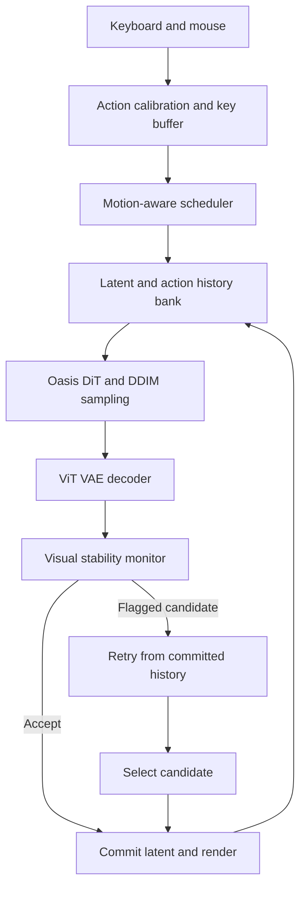
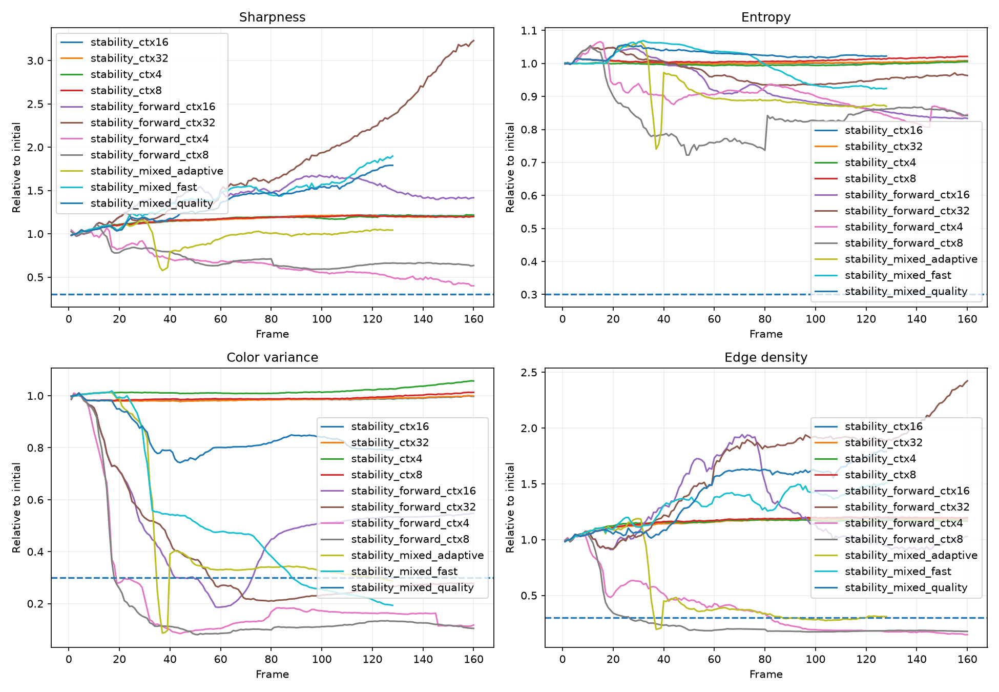

# Oasis Interactive World Model

**Action controllability, resource-efficient inference and long-horizon stability on a consumer GPU.**

An experimental extension of the pretrained Oasis 500M world model by Decart and Etched. This project converts offline action-conditioned video generation into online keyboard/mouse interaction and investigates inference efficiency, motion-induced visual degradation, and adaptive temporal sampling. No new model weights were trained.

## Results at a glance

- **2.95×** generation throughput (1.199 → 3.531 FPS), **66.1%** lower mean frame latency and **63.2%** lower peak allocated GPU memory in the 24-frame performance ablation.
- Continuous forward motion: first sustained degradation detected at frame 27 with context 8; none detected within 160 frames with context 16, at 10 DDIM steps. Manual interaction also showed reduced downward drift.
- Adaptive inference prototype: 128-frame mixed-action rollout, 0.813 FPS, 2 of 5 flagged candidates recovered according to a heuristic monitor. It is not yet superior to fixed-window baselines overall.

## Architecture



### Implementation contributions

- 25-dimensional action encoding, mouse dead zone and asymmetric sensitivity/clipping, keyboard event buffering, online latent rollout and per-frame rendering.
- FP16 model weights, PyTorch SDPA backend ablations, bounded context and DDIM step selection.
- Motion-aware temporal scheduler and aligned latent/action bank (up to 32 states); default computation cap 16.
- Visual degradation monitor (Laplacian variance, grayscale entropy, spatial color variance and edge density), candidate retry and per-frame reporting.

## Setup

Tested with WSL Ubuntu, Python 3.11, PyTorch 2.8.0+cu128, RTX 5060 Laptop GPU (8 GB). Install a compatible CUDA PyTorch/torchvision build first.

```bash
git clone https://github.com/engrenage0409/Oasis-Interactive-World-Model.git
cd Oasis-Interactive-World-Model
pip install einops diffusers timm av safetensors pygame numpy pillow matplotlib huggingface_hub
mkdir -p weights
hf download Etched/oasis-500m oasis500m.safetensors vit-l-20.safetensors --local-dir weights
```

Authenticate with Hugging Face if required and follow the model repository terms. Weights are not included in this repository.

```bash
python generate.py --oasis-ckpt weights/oasis500m.safetensors --vae-ckpt weights/vit-l-20.safetensors
python interactive_optimized.py --mode balanced --sensitivity 0.002
python interactive_adaptive.py --max-context 16
```

Controls: WASD, mouse look, space jump, P pause, R reset, Escape exit. Generation is slower than ordinary game rendering; a held key may be necessary.

## Performance ablation

24 generated frames, seed 0, three warmup frames for the baseline. Metrics are model-step throughput including decoding, not display refresh rate or input-to-display latency. GPU memory is peak PyTorch allocation, not total GPU usage.

| Method | Context | DDIM | FPS | Mean ms | GPU GiB | Laplacian variance |
|---|---:|---:|---:|---:|---:|---:|
| FP32 + AMP, auto SDPA | 8 | 10 | 1.199 | 834.34 | 4.31 | 1490.83 |
| FP16, auto | 8 | 10 | 1.330 | 751.63 | 1.60 | 1492.98 |
| FP16, Flash | 8 | 10 | 1.374 | 727.68 | 1.60 | 1492.98 |
| FP16, Efficient | 8 | 10 | 1.428 | 700.39 | 1.60 | 1492.93 |
| Short context | 4 | 10 | 2.223 | 449.84 | 1.59 | 1448.67 |
| Reduced DDIM | 8 | 6 | 2.330 | 429.15 | 1.60 | 1565.04 |
| Combined | 4 | 6 | 3.531 | 283.17 | 1.59 | 1463.53 |

Last three configurations use FP16 + Efficient SDPA. GPU reduction is 63.2% using unrounded CSV values; process peak RAM remains around 5.2 GiB. Laplacian variance changes by -1.83% in Combined; this is a texture proxy, not proof of preserved overall quality.

## Long-horizon stability

160-frame fixed idle and forward-only rollouts, FP16 + Efficient SDPA, DDIM 10.

| Context | Idle collapse detected | Forward collapse detected | Forward FPS |
|---:|---|---|---:|
| 4 | None | 83 | 2.078 |
| 8 | None | 27 | 1.319 |
| 16 | None | None | 0.746 |
| 32 | None | None | 0.396 |



Collapse is defined heuristically as at least two of four normalized image metrics falling below 30% of the first-five-frame median for five consecutive frames. None means no detection within the tested horizon. It does not establish camera pose or geometric consistency. Context effects are not monotonic; multiple seeds and scenes are needed.

## Adaptive inference

Idle: context 4 / DDIM 6. Movement: context 16 / DDIM 10 with a motion hold counter. Risk: up to configured context cap / DDIM 15. Flagged candidate frames are retried once from committed latent history. If both fail, the higher-score candidate can still be committed. This is candidate resampling, not arbitrary world rollback.

Mixed sequence: 16 idle, 40 forward, 16 idle, 16 yaw, 24 backward, 16 idle.

| Policy | FPS | Mean ms | GPU GiB | Laplacian variance | Sustained collapse |
|---|---:|---:|---:|---:|---|
| Fast (4,6) | 3.555 | 281.30 | 1.59 | 2130.79 | None |
| Quality (16,10) | 0.760 | 1315.82 | 1.63 | 2036.07 | None |
| Adaptive | 0.813 | 1229.57 | 1.63 | 1473.55 | None |

Adaptive selected mean context 13 and mean DDIM 9.234375; 5 retry attempts, 2 passed the monitor, 3 committed degraded frames. About 7% faster than Quality but 27.6% lower Laplacian variance. Fast also passed this mixed-action collapse test, so overall adaptive superiority is not established. Selected settings exclude extra retry compute, which is included in elapsed latency. A separate 31-frame interactive report records 0.888 model-step FPS, no flagged frames and no retries.

## Reproduce experiments

```bash
python create_test_actions.py
python benchmark.py --name baseline --precision fp32 --backend auto --context 8 --ddim-steps 10
python benchmark.py --name combined --precision fp16 --backend efficient --context 4 --ddim-steps 6
python summarize_benchmark.py
```

For the long tests, create the ignored local action tensors:

```python
import torch
from pathlib import Path
from utils import ACTION_KEYS
p = Path("test_actions")
p.mkdir(exist_ok=True)
a = torch.zeros(160, len(ACTION_KEYS))
torch.save(a, p / "idle_long.one_hot_actions.pt")
a[:, ACTION_KEYS.index("forward")] = 1
torch.save(a, p / "forward_long.one_hot_actions.pt")
a = torch.zeros(128, len(ACTION_KEYS))
a[16:56, ACTION_KEYS.index("forward")] = 1
a[72:88, ACTION_KEYS.index("cameraY")] = 0.10
a[88:112, ACTION_KEYS.index("back")] = 1
torch.save(a, p / "mixed_long.one_hot_actions.pt")
```

```bash
for ctx in 4 8 16 32; do
  python benchmark.py --name stability_forward_ctx$ctx --precision fp16 --backend efficient --context $ctx --ddim-steps 10 --frames 160 --warmup 2 --actions-path test_actions/forward_long.one_hot_actions.pt
done
python benchmark_adaptive.py --name stability_mixed_adaptive --precision fp16 --backend efficient --context 16 --ddim-steps 10 --frames 128 --warmup 2 --actions-path test_actions/mixed_long.one_hot_actions.pt
python analyze_stability.py
```

Raw results: [summary CSV](benchmarks/summary.csv), [adaptive report](benchmarks/stability_mixed_adaptive/adaptive_report.json), [interactive report](benchmarks/adaptive_interactive.json). Regenerate full frames locally for analysis; generated frame directories are ignored. Adaptive configuration fields in the generic CSV can reflect the last active setting rather than the rollout average; use the adaptive report.

## Repository map

| File | Purpose |
|---|---|
| interactive.py | Initial online interaction |
| interactive_bench.py | Precision-selectable inference and calibrated input |
| interactive_optimized.py | Fixed inference modes |
| adaptive_world.py | History bank, scheduler, monitoring and retry |
| interactive_adaptive.py | Adaptive interactive launcher |
| benchmark.py / benchmark_adaptive.py | Controlled rollout measurement |
| create_test_actions.py | Fixed action sequences |
| summarize_benchmark.py / analyze_stability.py | Reporting and degradation analysis |
| generate.py / dit.py / vae.py / attention.py | Upstream inference and model components |

## Limitations

Single-run experiments; no demonstrated persistent 3D memory, pose estimation or full world-state recovery. Texture statistics can flag legitimate low-texture scenes or miss semantic drift. Evaluate multiple seeds, prompts, action fidelity and temporal/geometric consistency; profile actual SDPA dispatch and input-to-display latency. Adaptive scheduling needs further tuning.

## Credits and license

Original Oasis 500M architecture, weights, upstream inference code and original media are by [Decart](https://www.decart.ai/) and [Etched](https://www.etched.com/). See the [original project](https://oasis-model.github.io/) and [model weights](https://huggingface.co/Etched/oasis-500m). Original README preserved below. Source license: [MIT](LICENSE), copyright 2024 Etched & Decart. Model weights are subject to their own terms.

<details>
<summary>Original upstream README</summary>

# Oasis 500M


Oasis is an interactive world model developed by [Decart](https://www.decart.ai/) and [Etched](https://www.etched.com/). Based on diffusion transformers, Oasis takes in user keyboard input and generates gameplay in an autoregressive manner. We release the weights for Oasis 500M, a downscaled version of the model, along with inference code for action-conditional frame generation. 

For more details, see our [joint blog post](https://oasis-model.github.io/) to learn more.

And to use the most powerful version of the model, be sure to check out the [live demo](https://oasis.us.decart.ai/) as well!

## Setup
```
git clone https://github.com/etched-ai/open-oasis.git
cd open-oasis
# Install pytorch
pip install torch torchvision --index-url https://download.pytorch.org/whl/cu121
# Install other dependencies
pip install einops diffusers timm av
```

## Download the model weights
Inside the `open-oasis/` directory, run:
```
huggingface-cli login
huggingface-cli download Etched/oasis-500m oasis500m.safetensors # DiT checkpoint
huggingface-cli download Etched/oasis-500m vit-l-20.safetensors  # ViT VAE checkpoint
```

## Basic Usage
We include a basic inference script that loads a prompt frame from a video and generates additional frames conditioned on actions.
```
python generate.py
# Or specify path to checkpoints:
python generate.py --oasis-ckpt <path to oasis500m.safetensors> --vae-ckpt <path to vit-l-20.safetensors>
```
Use a custom image prompt:
```
python generate.py --prompt-path <path to .png, .jpg, or .jpeg>
```
The resulting video will be saved to `video.mp4`. Here's are some examples of a generation from this 500M model!


</details>
